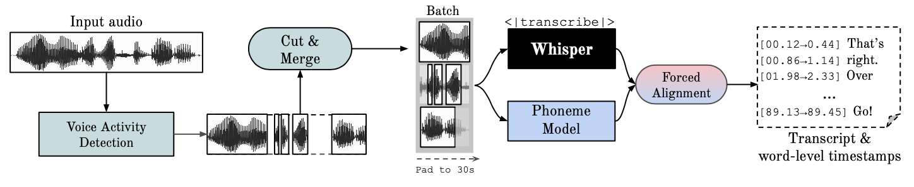

<h1 align="center">WhisperX</h1>

<p align="center">
  <a href="README.md">English</a> · <b>简体中文</b>
</p>

## Recall.ai - 会议转录 API (Meeting Transcription API)

如果您正在寻找专用于各类会议的转录 API，欢迎了解 [Recall.ai 的会议转录 API](https://www.recall.ai/product/meeting-transcription-api?utm_source=github&utm_medium=sponsorship&utm_campaign=mbain-whisperx)，该 API 支持 Zoom、Google Meet、Microsoft Teams 等多种平台。Recall.ai 通过直接从会议平台获取说话人数据和独立音频流来进行日志分离，这意味着能够获得 100% 准确的说话人分离效果以及真实的说话人姓名。


<p align="center">
  <a href="https://github.com/m-bain/whisperX/stargazers">
    
  </a>
  <a href="https://github.com/m-bain/whisperX/issues">
        
  </a>
  <a href="https://github.com/m-bain/whisperX/blob/master/LICENSE">
        
  </a>
  <a href="https://arxiv.org/abs/2303.00747">
        
  </a>
  <a href="https://twitter.com/intent/tweet?text=&url=https%3A%2F%2Fgithub.com%2Fm-bain%2FwhisperX">
  
  </a>
</p>



<!-- <p align="left">基于 Whisper 的自动语音识别（ASR），通过音素强制对齐和基于语音活动检测的批处理实现更高的微秒级时间戳精度、转录质量与快速推理。</p> -->

<!-- <h2 align="left", id="what-is-it">项目介绍 🔎</h2> -->

本项目提供极速自动语音识别（使用 large-v2 模型可达 70 倍实时速率），支持词级时间戳与说话人日志分离（Speaker Diarization）。

- ⚡️ **批处理推理**：使用 whisper large-v2 模型实现 70 倍实时转录
- 🪶 **[faster-whisper](https://github.com/guillaumekln/faster-whisper) 后端**：使用 beam_size=5 运行 large-v2 时显存占用低于 8GB
- 🎯 **精准词级时间戳**：基于 wav2vec2 音素对齐
- 👯‍♂️ **多说话人 ASR**：集成 [pyannote-audio](https://github.com/pyannote/pyannote-audio) 实现说话人日志分离（说话人 ID 标签）
- 🗣️ **VAD 预处理**：语音活动检测预处理，有效抑制幻觉并支持批处理，且不会恶化词错误率（WER）

**Whisper** 是由 [OpenAI 开发](https://github.com/openai/whisper)的 ASR 模型，在海量多样化音频数据集上训练而成。尽管它能生成高准确率的转录文本，但对应的时间戳处于语句级（utterance-level）而非逐词级，且可能存在数秒的偏差。此外，OpenAI 原生 whisper 并不支持批处理。

**基于音素的 ASR (Phoneme-Based ASR)** 是一系列经过微调的模型，用于识别区分词语的最小语音单位（音素），例如 "tap" 中的 "p" 音素。其中一个广为人知的示例模型是 [wav2vec2.0](https://huggingface.co/facebook/wav2vec2-large-960h-lv60-self)。

**强制对齐 (Forced Alignment)** 指将正字法转录文本与对应音频录音进行精准对齐，以自动生成音素级别时间切片的过程。

**语音活动检测 (Voice Activity Detection, VAD)** 用于检测音频中是否存在人类语音。

**说话人日志分离 (Speaker Diarization)** 是指根据说话人的身份，将包含人类语音的音频流分割为按说话人归类的同质片段的过程。

<h2 align="left", id="highlights">最新动态 🚨</h2>

- 荣获 [Ego4d 转录挑战赛](https://eval.ai/web/challenges/challenge-page/1637/leaderboard/3931/WER) 第一名 🏆
- _WhisperX_ 正式被 INTERSPEECH 2023 录用
- v3 版本发布，70 倍极速加速全面开源！基于 [faster-whisper](https://github.com/guillaumekln/faster-whisper) 后端实现批处理 whisper 推理！
- 2026 年发布上下文感知批处理（Context-Aware Batching）：在批处理转录框架中成功启用了 `condition_on_previous_context`，大幅改善标点符号与专有名词的一致性。详见 [ArXiv 预印本论文](https://arxiv.org/abs/2608.31170)。

<h2 align="left" id="setup">环境配置与安装 ⚙️</h2>

### 0. CUDA 安装

若要在 GPU 加速环境下使用 WhisperX，请在安装 WhisperX 之前先安装 CUDA Toolkit 12.8。如果仅在 CPU 上运行，可跳过此步骤。

- **Linux** 用户：请参考官方指南安装 CUDA Toolkit 12.8：
  [Linux CUDA 安装指南](https://docs.nvidia.com/cuda/cuda-installation-guide-linux/)。
- **Windows** 用户：请下载并安装 CUDA Toolkit 12.8：
  [CUDA 下载中心](https://developer.nvidia.com/cuda-12-8-1-download-archive)。

### 1. 基础安装（推荐）

安装 WhisperX 最简便的方式是通过 PyPI：

```bash
pip install whisperx
```

如果使用 [uvx](https://docs.astral.sh/uv/guides/tools/#running-tools)：

```bash
uvx whisperx
```

### 2. 进阶安装选项

以下安装方式面向开发者或有特定需求的用户。如果不确定，建议采用上述基础安装方式。

#### 选项 A：直接从 GitHub 安装

直接从 GitHub 仓库安装最新代码：

```bash
uvx git+https://github.com/m-bain/whisperX.git
```

#### 选项 B：开发者安装

如果需要修改代码或参与项目贡献：

```bash
git clone https://github.com/m-bain/whisperX.git
cd whisperX
uv sync --all-extras --dev
```

> **注意**：开发版本可能包含实验性功能和未决缺陷。生产环境建议使用 PyPI 发布的稳定版本。

可能还需要安装 ffmpeg、rust 等系统依赖。请参考 OpenAI 的安装指引：https://github.com/openai/whisper#setup 。

### 加速强制对齐（可选）

WhisperX 采用动态规划算法进行音素对齐。对于长音频文件或 GPU 上的批处理流水线，可以通过安装 Numba 将对齐速度提升 30×–100×：

```bash
pip install "whisperx[fast]"
# 或：pip install numba
```

安装 Numba 后，WhisperX 将自动启用 JIT 编译的对齐循环。若未安装 Numba，系统将无缝自动回退至原生 PyTorch 实现，无需任何额外配置。

### 说话人日志分离 (Speaker Diarization)

若要**启用说话人日志分离**，请在 `--hf_token` 参数后传入您的 Hugging Face 访问令牌（只读权限，可从[此处](https://huggingface.co/settings/tokens)生成），并在 Hugging Face 上签署接受 [speaker-diarization-community-1](https://huggingface.co/pyannote/speaker-diarization-community-1) 模型的用户使用协议。

<h2 align="left" id="example">使用方法 💬（命令行）</h2>

### 英语 (English)

在示例音频片段上运行 whisper（使用默认参数与 whisper small 模型），添加 `--highlight_words True` 可在生成的 `.srt` 字幕文件中直观呈现词级时间高亮：

    whisperx path/to/audio.wav

使用 _WhisperX_ 配合 wav2vec2.0 large 进行强制对齐的效果：

https://user-images.githubusercontent.com/36994049/208253969-7e35fe2a-7541-434a-ae91-8e919540555d.mp4

对比原生未修改的 whisper 开箱效果（许多转录时间戳严重不同步）：

https://user-images.githubusercontent.com/36994049/207743923-b4f0d537-29ae-4be2-b404-bb941db73652.mov

如需进一步提升时间戳精度（以消耗更多 GPU 显存为代价），可以使用更大的模型（更大的对齐模型收效不明显，详见论文），例如：

    whisperx path/to/audio.wav --model large-v2 --align_model WAV2VEC2_ASR_LARGE_LV60K_960H --batch_size 4

为转录文本添加说话人 ID 标签（若已知说话人数，可预先设定，例如 `--min_speakers 2` `--max_speakers 2`）：

    whisperx path/to/audio.wav --model large-v2 --diarize --highlight_words True

保持连续上下文（非常适合专业技术用语 / 标点符号规范），请设置 `interleaved_context=True`：

    whisperx path/to/audio.wav --model large-v2 --interleaved_context

在 CPU 而非 GPU 上运行（适用于 Mac OS X 环境）：

    whisperx path/to/audio.wav --compute_type int8 --device cpu

基于先前上下文进行条件化（允许将前一片段的上下文传递至当前片段，显著提升长音频处理效果）：

    whisperx path/to/audio.wav --model large-v2 --interleaved_context


### 其他语言 (Other languages)

音素 ASR 对齐模型是**针对特定语言的**（language-specific）。对于已通过测试的语言，这些模型会[自动从 torchaudio pipelines 或 Hugging Face 获取](https://github.com/m-bain/whisperX/blob/f2da2f858e99e4211fe4f64b5f2938b007827e17/whisperx/alignment.py#L24-L58)。
只需传入 `--language` 语言代码，并配合使用 `--model large`：

目前已通过 torchaudio pipelines 为 `{en, fr, de, es, it}` 提供默认模型，并通过 Hugging Face 支持更多语言。请在 [alignment.py](https://github.com/m-bain/whisperX/blob/main/whisperx/alignment.py) 的 `DEFAULT_ALIGN_MODELS_HF` 中查阅当前支持的完整语言列表。若检测到的语言不在该列表中，需要从 [Hugging Face 模型中心](https://huggingface.co/models)寻找对应的基于音素的 ASR 模型，并在自己的数据上进行测试。

#### 例如德语 (German)：

    whisperx --model large-v2 --language de path/to/audio.wav

https://user-images.githubusercontent.com/36994049/208298811-e36002ba-3698-4731-97d4-0aebd07e0eb3.mov

更多其他语言的使用示例请参阅[此处](EXAMPLES.md)。

## Python 使用方式 🐍

```python
import whisperx
import gc
from whisperx.diarize import DiarizationPipeline

device = "cuda"
audio_file = "audio.mp3"
batch_size = 16 # 若 GPU 显存紧张可适当调小
compute_type = "float16" # 若显存不足可改为 "int8"（可能会轻微降低精度）

# 1. 使用原生 whisper 转录（批处理模式）
model = whisperx.load_model("large-v2", device, compute_type=compute_type)

# 保存模型至本地路径（可选）
# model_dir = "/path/"
# model = whisperx.load_model("large-v2", device, compute_type=compute_type, download_root=model_dir)

audio = whisperx.load_audio(audio_file)

result = model.transcribe(audio, batch_size=batch_size, interleaved_context=True)
print(result["segments"]) # 对齐前的转录结果

# 若 GPU 资源紧张，可在此释放模型
# import gc; import torch; gc.collect(); torch.cuda.empty_cache(); del model

# 2. 对 whisper 输出结果进行强制对齐
model_a, metadata = whisperx.load_align_model(language_code=result["language"], device=device)
result = whisperx.align(result["segments"], model_a, metadata, audio, device, return_char_alignments=False)

print(result["segments"]) # 对齐后的转录结果

# 若 GPU 资源紧张，可在此释放对齐模型
# import gc; import torch; gc.collect(); torch.cuda.empty_cache(); del model_a

# 3. 分配说话人标签
diarize_model = DiarizationPipeline(token=YOUR_HF_TOKEN, device=device)

# 若已知说话人数量，可设置最少/最多人数
diarize_segments = diarize_model(audio)
# diarize_model(audio, min_speakers=min_speakers, max_speakers=max_speakers)

result = whisperx.assign_word_speakers(diarize_segments, result)
print(diarize_segments)
print(result["segments"]) # 此时各片段已成功分配说话人 ID
```

## 在线演示 (Demos) 🚀

[](https://replicate.com/victor-upmeet/whisperx)
[](https://replicate.com/daanelson/whisperx)
[](https://replicate.com/carnifexer/whisperx)

如果本地没有可用的 GPU 算力，可通过上方链接在线体验 WhisperX。

<h2 align="left" id="whisper-mod">技术细节 👷‍♂️</h2>

有关批处理与对齐算法的具体实现、VAD 语音活动检测带来的影响以及对齐模型选型的详细分析，请参阅预印本[学术论文](https://www.robots.ox.ac.uk/~vgg/publications/2023/Bain23/bain23.pdf)。

为降低 GPU 显存需求，可尝试以下任一方法（第 2 与第 3 项可能会影响生成质量）：

1.  减小批大小（batch size），例如 `--batch_size 4`
2.  使用更小规格的 ASR 模型，例如 `--model base`
3.  采用更轻量的计算精度，例如 `--compute_type int8`

与 OpenAI 原版 Whisper 的转录差异：

1. **无时间戳转录**：为实现单次前向传递批处理，whisper 推理默认采用 `--without_timestamps True`，确保批次中的每个样本仅需执行 1 次前向传递。但这可能会导致转录文本与 OpenAI whisper 默认输出存在微小差异。
2. **基于 VAD 的分段转录**：区别于 OpenAI 的缓冲式转录（buffered transcription）。在 WhisperX 论文中证明了该机制不仅能降低 WER，还能实现高精度的批处理推理。
3. `--condition_on_prev_text` 默认设置为 `False`（有效减少文本幻觉）。

<h2 align="left" id="limitations">局限性 ⚠️</h2>

- 若转录词汇中包含对齐模型字符字典未收录的字符（例如 "2014." 或 "£13.60"），则无法完成对齐，因此无法获得对应的时间戳。
- Whisper 与 WhisperX 目前对重叠语音（Overlapping speech）的处理效果均不够理想。
- 说话人日志分离（Diarization）仍有进一步提升空间。
- 需要针对特定语种配置相应的 wav2vec2 对齐模型。

<h2 align="left" id="contribute">参与贡献 🧑‍🏫</h2>

如果您精通多种语言，参与本项目贡献的一个重要途径是在 Hugging Face 上寻找适用的音素模型（或自行训练），并在目标语言语音数据上进行测试。如果测试效果良好，欢迎提交 Pull Request 并附上展示成功效果的使用示例。

非常欢迎提出缺陷报告（Bug finding）与提交 Pull Request，共同维护和推动本项目的发展，目前项目的功能已逐步拓展超出最初的研究范畴。

<h2 align="left" id="coming-soon">开发路线图 (TODO) 🗓</h2>

- [x] 多语言初始化支持

- [x] 基于语种自动检测选取对齐模型

- [x] Python API 调用支持

- [x] 集成说话人日志分离（Speaker Diarization）

- [x] 模型显存主动释放机制，适配低显存环境

- [x] 集成 Faster-whisper 高性能推理后端

- [x] 增加 max-line 等工具支持（参考 openai whisper utils.py）

- [x] 句子级分段切分（nltk 工具箱）

- [x] 优化对齐算法逻辑

- [ ] 更新包含说话人日志分离与逐词高亮的示例代码

- [ ] 恢复 `.ass` 字幕格式导出（在 v3 中曾暂时移除）

- [ ] 添加基准测试代码（基于 TEDLIUM 测试速度 / WER 及逐词切分性能）

- [x] 支持 silero-vad 作为备选 VAD 方案

- [ ] 持续改进词级说话人日志分离（难度高于最初预期……）

<h2 align="left" id="contact">联系与支持 📇</h2>

如有疑问或交流，可联系邮箱：maxhbain@gmail.com 。

<a href="https://www.buymeacoffee.com/maxhbain" target="_blank"></a>

<h2 align="left" id="acks">致谢 🙏</h2>

本研究工作及作者的博士课题由牛津大学工程科学系 [VGG (Visual Geometry Group)](https://www.robots.ox.ac.uk/~vgg/) 提供支持。

当然，本项目深度构建于 [OpenAI Whisper](https://github.com/openai/whisper) 之上。
核心对齐代码借鉴了 [PyTorch 官方基于 torchaudio 的强制对齐教程](https://pytorch.org/tutorials/intermediate/forced_alignment_with_torchaudio_tutorial.html)。
同时使用了优秀的 pyannote VAD / Diarization 库：https://github.com/pyannote/pyannote-audio 。

核心 VAD 与日志分离模型致谢：

- [pyannote-audio](https://github.com/pyannote/pyannote-audio) — 说话人日志分离基于 [speaker-diarization-community-1](https://huggingface.co/pyannote/speaker-diarization-community-1) 模型构建，由 [pyannoteAI](https://www.pyannote.ai) 依据 [CC-BY-4.0](https://creativecommons.org/licenses/by/4.0/) 许可证授权发布
- [silero-vad](https://github.com/snakers4/silero-vad)

出色的高性能推理后端由 [faster-whisper](https://github.com/guillaumekln/faster-whisper) 与 [CTranslate2](https://github.com/OpenNMT/CTranslate2) 提供。

诚挚感谢通过 [Buy Me A Coffee](https://www.buymeacoffee.com/maxhbain) 给予本项目经济支持的朋友 🙏。

最后，感谢为本项目贡献代码、排查缺陷的全体开源[贡献者](https://github.com/m-bain/whisperX/graphs/contributors)，推动项目持续演进。

<h2 align="left" id="cite">论文引用 (Citation)</h2>

如果您在学术研究中使用了本项目，请引用本论文：

```bibtex
@article{bain2022whisperx,
  title={WhisperX: Time-Accurate Speech Transcription of Long-Form Audio},
  author={Bain, Max and Huh, Jaesung and Han, Tengda and Zisserman, Andrew},
  journal={INTERSPEECH 2023},
  year={2023}
}
```

若在转录中启用了交错上下文（interleaved context），请同时引用以下论文：

```bibtex
@article{bain2026context,
  title={Context-Aware Interleaved Batching for WhisperX},
  author={Bain, Carlos and Bain, Max},
  journal={arXiv preprint arXiv:2608.31170v1},
  year={2026}
}
```

---

> **翻译说明（Translation Disclaimer）**
> 本文档由社区志愿者（[@JasonYeYuhe](https://github.com/JasonYeYuhe)）人工翻译并维护，旨在降低中文开发者的阅读门槛。最后同步日期：2026年11月16日。若译文与英文原版存在任何出入或滞后，请以 [英文原版 (README.md)](README.md) 为准。欢迎通过 PR 协助改进译文！
